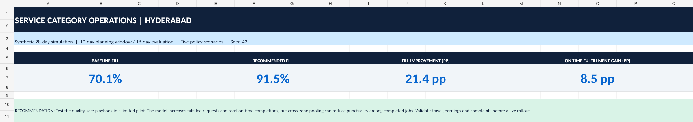

# Hyperlocal Service Supply & Quality Optimization — Independent Case Study

> **Portfolio project for Category Manager / Business Operations roles.** A fully reproducible, synthetic marketplace simulation inspired by public home-services categories and the user-provided job description. **Not affiliated with, commissioned by, or powered by private Urban Company data.** All numeric results are MODEL ESTIMATES and should never be represented as real-world company outcomes.



## Executive result

- **City modeled:** Hyderabad; 8 illustrative micro-markets, 3 verified public service lines (AC Repair, Bathroom Cleaning, Electrician)
- **Study:** September 1–28, 2026 (synthetic); **5 scenarios**; 10 planning days + 18-day evaluation holdout; **1,925 held-out requests** from **2,954 generated requests across 28 days**; complete dataset in `data/synthetic_orders.csv`
- **Partner cohorts:** 96 existing synthetic partners, 45 candidate profiles, 12 screened selections
- **Recommended:** `Quality-Safe Playbook` = one-hop pooling + qualified onboarding + assumed effectiveness of quality coaching (not a proven causal result)
- **Completed requests:** 1,350 → 1,762 (**+412**)
- **Fill rate:** 70.13% → 91.53% (**+21.40 percentage points**)
- **On-time fulfillment across ALL requests:** 70.13% → 78.60% (**+8.47 pp**)
- **Complaint rate of completed requests:** 10.96% → 10.33%; training impacts are ASSUMED, not field-validated.
- **Illustrative program spend:** ₹43,650; **₹105.95 cost per incremental completed request** across this 18-day simulation, not actual incremental contribution margin or realized ROI.

**Important caveat:** Baseline's conditional on-time rate is 100% because it dispatches only within each home zone and all modeled local trips fit the illustrative 45-minute threshold. That does *not* mean 100% of customer requests were served on time. Using all requests as the denominator reveals the correct 70.13% baseline. Cross-zone pooling improves availability but can increase late arrivals among completed bookings.

## Files

| Path | Contents |
|---|---|
| `src/simulate.py` | Standard-library synthetic demand generation, partner matching, screening, policy experiments, stress tests |
| `src/build_db.py` + `sql/ops_diagnostics.sql` | SQLite warehouse, 5 auditable operations queries |
| `src/build_html.py` | Offline interactive HTML with scenario, locality, category and time-slot filters |
| `src/build_workbook.py` | Excel workbook builder using optional `artifact_tool` dependency |
| `src/build_brief.py` | PDF leadership brief builder using `reportlab` |
| `data/` | Reproducible input master data and illustrative assumptions |
| `results/` | Detailed order outcomes, scenario metrics, segmentation, onboarding/shift plan, stress runs, SQLite DB |
| `dashboard/interactive_dashboard.html` | Open directly in any modern browser (no server, CDN or login) |
| `dashboard/Category_Operations_Dashboard.xlsx` | 7-sheet Excel scorecard and operational drilldown |
| `reports/Management_Brief.pdf` | Two-page decision brief |
| `docs/` | Case study, data dictionary, SOPs, interview narration, public-source provenance |
| `tests/` | Integrity and determinism checks |

## Run from a clean clone

Requires **Python 3.10+**. Core simulation, HTML dashboard, and SQLite require **no third-party Python packages**.

```bash
python src/simulate.py --seed 42 --sensitivity
python -m unittest discover -s tests -v
python src/build_db.py
python src/build_html.py
```

The packaged Excel and PDF are ready to open. Rebuild them in the creation environment with the optional dependencies:

```bash
# optional, if artifact_tool is available in your Python environment
python src/build_workbook.py
# optional, after installing reportlab
python src/build_brief.py
```

Sensitivity uses seeds 21, 42, 63, 84, 105; request arrivals, partner availability and customer outcomes are deterministic for each seed. The planning algorithm uses **days 1–10 only** and evaluates recommendations on **days 11–28**, preventing same-period demand information from entering the intervention choice. The scenarios are paired on identical demand tapes per seed.

## Comparison on the held-out evaluation window

| Policy | Completed | Fill rate | On-time / all requests | On-time / completed | Complaints / completed | Illustrative spend |
|---|---:|---:|---:|---:|---:|---:|
| Baseline | 1,350 | 70.13% | 70.13% | 100.00% | 10.96% | ₹0 |
| Zone Pooling | 1,706 | 88.62% | 74.75% | 84.35% | 12.08% | ₹0 |
| Pooling + Onboarding | 1,750 | 90.91% | 78.08% | 85.89% | 12.06% | ₹18,000 |
| Quality-Safe Playbook | 1,762 | 91.53% | 78.60% | 85.87% | 10.33% | ₹43,650 |
| Peak-Shift Experiment | 1,757 | 91.27% | 76.57% | 83.89% | 10.02% | ₹46,850 |

**Interpretation:** `Quality-Safe Playbook` provides a defensible illustrative balance of fulfillment, service reliability and complaint control. `Peak-Shift Experiment` changes flexible partner two-slot schedules without increasing daily slots, but worsens overall on-time fulfillment vs the quality-safe alternative in this sample; do not claim that reshuffling helped without validation.

## Core decision logic

1. Generate service requests from declared assumptions for day × zone × category × slot, with seeded Poisson demand and weekend variation.
2. Generate synthetic partner pools with service skill, home zone, schedule, weekly rest day, acceptance probability, completion reliability and training/quality values.
3. During planning days 1–10, estimate shortage pressure = observed demand / expected local available slot capacity by category × zone.
4. Select 12 **verified, training-passed** candidate profiles, ranked by shortage pressure and a diminishing-return term. Activate only after their modeled readiness day.
5. Dispatch each held-out request to up to 3 eligible professionals with free capacity, matching service category, day/slot availability and local/adjacent zone policy.
6. Simulate willingness to accept, cancellations, 45-minute on-time travel proxy and complaint risk. Baseline, pooling, onboarding, coaching and peak-shift policies share demand tape and seeded outcomes.
7. Compare five scenarios across booked fulfillment, on-time completion over all requests, complaints, cost per incremental completion, supply availability, and capacity utilization.
8. Stress-test a 15% demand surge and a 10% partner availability decline, across five independent deterministic seeds. These are robustness checks, NOT confidence intervals or live A/B tests.

## Limitations and business safety

- Synthetic requests, demographics-free IDs, travel times, service durations, candidate assessments, ratings and financial assumptions; no scraped customer information.
- Hyderabad locality names are recognizable, but zone links are an **illustrative network**; model travel proxy is not estimated from roads or maps.
- Demand/cancellation/acceptance distributions are **not calibrated** to Urban Company's internal data. Service price proxies and onboarding/coaching costs are NOT Urban Company pricing or fee information.
- Model does not explicitly measure provider wages, out-of-pocket travel expenses, autonomy, satisfaction, churn, customer refunds, partner payout or equity. Never deploy policies without partner consent, welfare safeguards, verified service qualification and direct field observation.
- One deterministic seed is a demonstration, not statistical proof. Five seed sensitivity ranges are a diagnostic only.
- The simulated coaching effectiveness is an input assumption. **No causal effect of training has been demonstrated.**

## Public context / provenance

- Urban Company, public Hyderabad services page: https://www.urbancompany.com/Hyderabad (used to verify modeled service categories; *not* to infer volumes or prices).
- Urban Company Investor Relations, Service Professional Enablement, 28 June 2024: https://investorrelations.urbancompany.com/announcements-and-highlights/service-professional-enablement (operating context: partner training/quality, fulfillment and flexibility; not model calibration).
- Campus job description supplied by user: `Campus Category Manager (Business Operations).pdf`, page 2 (scope: quality supply onboarding, city operations and growth/quality initiatives). Not redistributed to respect ownership.

For model rules see `docs/methodology.md`, operational rollout plan `docs/operating_sop.md` and interview answers `docs/interview_walkthrough.md`.
